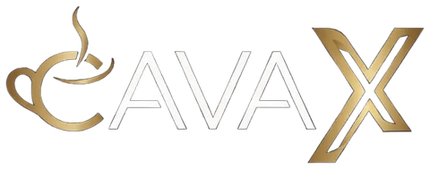

# CAVAX — Tecnologia que transforma ideias em soluções digitais.

  

  <strong>Desenvolvimento de software • Soluções digitais • Automação • Tecnologia</strong>

  Criamos experiências digitais, sistemas inteligentes e soluções tecnológicas para empresas que desejam evoluir, inovar e crescer.

---

## Sobre a CAVAX

A **CAVAX** é uma empresa de tecnologia dedicada ao desenvolvimento de soluções digitais personalizadas, combinando inovação, engenharia de software e visão estratégica para transformar necessidades reais em produtos tecnológicos.

Nosso objetivo é desenvolver ferramentas modernas, eficientes, seguras e escaláveis, ajudando empresas a otimizar processos, fortalecer sua presença digital e aproveitar novas oportunidades por meio da tecnologia.

Não desenvolvemos apenas sistemas. Construímos soluções pensadas para gerar resultados.

## Nossas soluções

| Área | Descrição |
|---|---|
| Desenvolvimento Web | Sites institucionais, landing pages e plataformas personalizadas. |
| Lojas Virtuais | E-commerces completos e experiências digitais de compra. |
| Sistemas e Plataformas | Sistemas administrativos, painéis e aplicações empresariais. |
| Automação e Inteligência Artificial | Integrações, automações e ferramentas inteligentes. |
| APIs e Integrações | Conexões entre sistemas, serviços e plataformas externas. |
| Segurança Digital | Implementação de boas práticas e mecanismos de proteção. |
| Infraestrutura e Hospedagem | Configuração, implantação e manutenção de aplicações. |

## Tecnologias

Nossa infraestrutura utiliza tecnologias modernas para desenvolver aplicações robustas e escaláveis.

**Backend**
- Node.js
- Express.js
- Java
- Spring Boot

**Frontend**
- HTML5
- CSS3
- JavaScript

**Banco de dados e armazenamento**
- MySQL
- WIO.DB

**Integrações e serviços**
- APIs REST
- WhatsApp Cloud API
- Mercado Pago
- Serviços de e-mail SMTP

**Infraestrutura e ferramentas**
- Git e GitHub
- Docker
- Linux
- Hospedagem em nuvem

> As tecnologias utilizadas variam conforme as necessidades e a arquitetura de cada projeto.

## Projetos e produtos

A CAVAX desenvolve projetos próprios e soluções sob medida para diferentes necessidades empresariais.

Entre as iniciativas estão:

- **Plataformas empresariais:** sistemas para gestão, operação e controle de processos.
- **Soluções de automação:** ferramentas para otimizar tarefas e comunicação.
- **Produtos digitais:** aplicações e serviços tecnológicos desenvolvidos pela CAVAX.

## Nosso compromisso

- Código organizado e de fácil manutenção.
- Arquitetura preparada para evolução.
- Segurança desde o desenvolvimento.
- Interfaces modernas e responsivas.
- Integrações confiáveis.
- Foco na experiência do usuário.
- Soluções desenvolvidas de acordo com cada necessidade.

## Desenvolvimento

Este repositório reúne o desenvolvimento e a evolução tecnológica dos projetos da CAVAX.

Cada aplicação possui suas próprias necessidades, arquitetura, documentação e ciclo de desenvolvimento.

## Contato

**CAVAX Tecnologia**

- Website: https://cavax.com.br
- GitHub: https://github.com/Vinicios2J
- E-mail: noreply@vatec-os.site

---

  <strong>CAVAX</strong> 
  Tecnologia que transforma ideias em soluções digitais.

  © CAVAX Tecnologia — Todos os direitos reservados.

